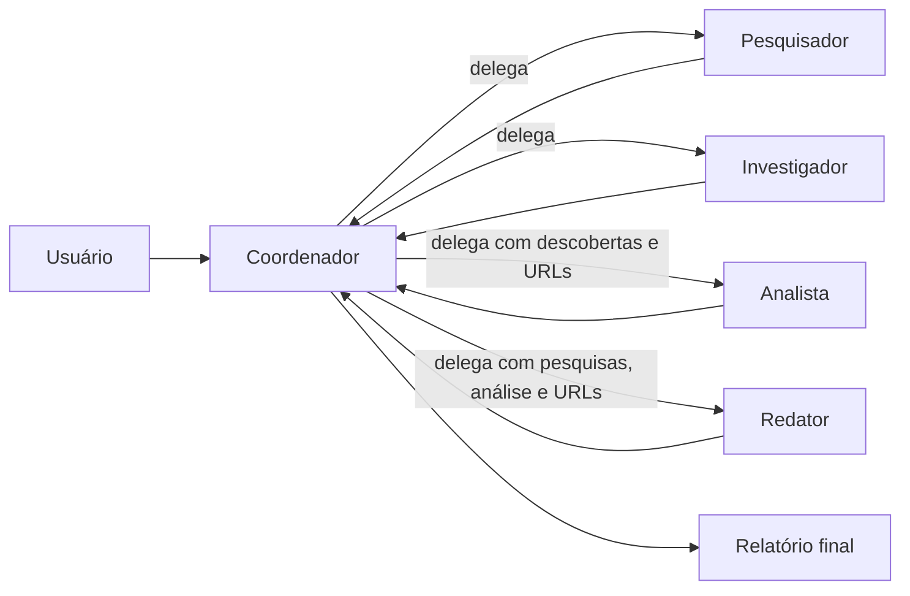

# Inteligência de Mercado Multiagente

Equipe de agentes de IA que pesquisa um mercado, analisa concorrentes, avalia oportunidades e devolve um relatório em Markdown.

Este foi meu primeiro projeto de agentes de IA, publicado para registrar essa etapa dos estudos. Não representa meu nível atual em agentes e engenharia de IA. É um exercício de estudo, com arquitetura simples. Não está pronto para produção.

[](https://www.python.org/)
[](https://docs.agno.com/)
[](https://platform.openai.com/)

## O problema

Avaliar um setor ou uma ideia de negócio costuma exigir pesquisa de mercado, leitura de concorrentes e alguma forma de priorizar oportunidades. Este projeto organiza essas etapas em especialistas que o coordenador pode acionar a partir de uma pergunta em português.

## Como a equipe funciona

O time vive em `main.py`. Quatro especialistas executam tarefas específicas. Um coordenador interpreta a pergunta, delega e entrega a resposta final.

| Papel | Responsabilidade | Ferramentas |
| --- | --- | --- |
| Coordenador de inteligência de mercado | Interpreta o pedido, delega e revisa a resposta | Modelo OpenAI |
| Pesquisador de mercado | Tendências, público e problemas do setor | Tavily |
| Investigador de concorrentes | 3 a 5 concorrentes, preços públicos e posicionamento | Tavily e busca na web |
| Analista de oportunidades | Escolhe oportunidades com as pesquisas e a base RAG | ChromaDB + `rag/base_oportunidades.md` |
| Redator de relatórios | Organiza o relatório em Markdown e preserva os URLs recebidos | Sem ferramenta de busca |

No Agno 2.9, o time não define `mode` e cai em `coordinate`. O coordenador escolhe quem chamar e escreve a tarefa de cada membro. As instruções pedem pesquisador e investigador antes do analista, e o redator por último. Essa ordem depende da delegação. O código não a impõe.



## Tecnologias

Versões conferidas no ambiente em que o projeto foi validado:

| Tecnologia | Função |
| --- | --- |
| Python 3.12 | Linguagem do projeto |
| Agno 2.9.0 | Agentes, time e AgentOS |
| OpenAI `gpt-4o-mini` | Modelo dos agentes |
| OpenAI `text-embedding-3-small` | Embeddings da base RAG |
| Tavily | Pesquisa do pesquisador e do investigador |
| ddgs 9.16.1 | Busca adicional do investigador |
| ChromaDB 1.5.9 | Índice vetorial local |
| Chonkie 1.7.0 | Recorte semântico do Markdown |
| SQLite | Histórico do time em `tmp/data.db` |
| python-dotenv | Leitura do `.env` |
| uv | Instalação das dependências |

## Estrutura

| Caminho | Conteúdo |
| --- | --- |
| `main.py` | Agentes, time, base RAG e AgentOS |
| `rag/base_oportunidades.md` | Orientações metodológicas para o analista |
| `examples/relatorio_exemplo.md` | Relatório real de uma execução concluída |
| `.env.example` | Nomes das variáveis de ambiente |
| `pyproject.toml` | Dependências do projeto |
| `tmp/` | SQLite e Chroma gerados na execução (ignorados no Git) |

## Instalação

Requisitos: Python 3.12+ e [uv](https://docs.astral.sh/uv/).

```bash
git clone https://github.com/iudicibus/inteligencia-mercado-multiagente.git
cd inteligencia-mercado-multiagente
cp .env.example .env
uv sync
```

No `.env`, preencha:

```bash
OPENAI_API_KEY=sua-chave
TAVILY_API_KEY=sua-chave
```

## Execução

```bash
uv run python main.py
```

O comando sobe o time no AgentOS. Os caminhos da base, do Chroma e do SQLite saem da pasta do arquivo, não do diretório em que o comando foi chamado.

Na primeira execução, a indexação de `rag/base_oportunidades.md` chama o embedding da OpenAI. `skip_if_exists=True` só pula a indexação quando o mesmo conteúdo já está no Chroma. Não vigia o Markdown nem substitui sozinho uma versão antiga.

## Exemplo de pergunta

> Quero abrir uma empresa de automações e agentes de IA para restaurantes em São Paulo. Analise o mercado, os concorrentes e as melhores oportunidades de negócio.

## Demonstração

Uma execução concluída, em 25 de novembro de 2026, às 16:17 (horário de Brasília), usou esta pergunta:

> Teste curto, uma rodada. Setor: cafeteria de especialidade em Pinheiros, São Paulo. Pesquisador: uma tendência recente e um link. Investigador: um concorrente real e um link. Analista: uma oportunidade curta com base nisso. Redator: relatório breve em Markdown, conservando os links recebidos. Não amplie a pesquisa.

Nessa rodada:

- os quatro especialistas foram chamados nesta ordem: pesquisador, investigador, analista e redator
- o analista consultou a base RAG e recebeu os quatro trechos de `rag/base_oportunidades.md`
- os URLs apareceram nas respostas do pesquisador e do investigador e na resposta final do coordenador
- as tarefas enviadas ao analista e ao redator nomearam as descobertas e não incluíram os URLs

O relatório final gravado nessa sessão está em [`examples/relatorio_exemplo.md`](examples/relatorio_exemplo.md).

Depois dessa execução, as instruções passaram a pedir que os URLs entrem por extenso nas tarefas do analista e do redator, e que o redator os preserve no relatório. Essas instruções novas ainda não foram repetidas numa segunda execução.

## Limitações e possíveis melhorias

- A ordem dos especialistas depende do coordenador. Uma fila rígida exigiria outro modo do Agno, como `tasks`, e não foi feita.
- A base RAG é metodologia, não dado atual de mercado.
- O redator não grava arquivo. O relatório sai na conversa.
- Pesquisa na web pode trazer informação incompleta ou desatualizada.
- Possíveis próximos passos: validar o repasse dos URLs em uma nova execução, ou adotar um fluxo com dependências explícitas entre tarefas.
